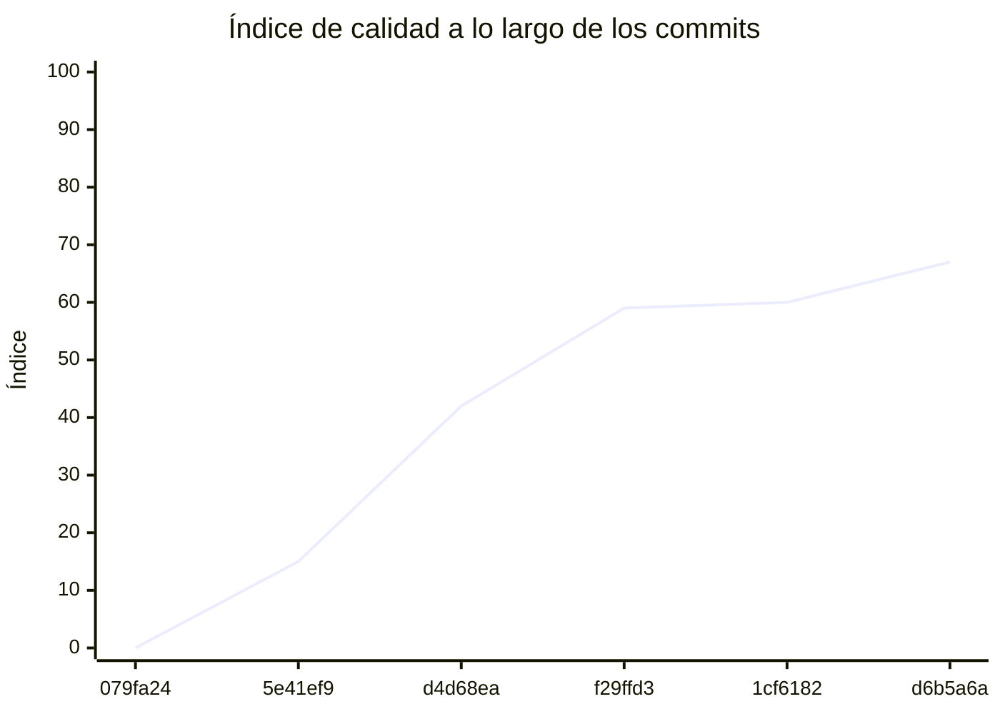

<!-- evaluacion:inicio -->
# Evaluación — Tejada-ProgramacionII/turnos-reservas-service

> Documento **generado automáticamente** por la cátedra de Programación II (UM): RepoSense + análisis de calidad de **7 dimensiones**. **No editar a mano**: se regenera en cada evaluación.
> Rama evaluada: `main`. Análisis **heurístico** (regex + métricas) + build: es una criba para orientar la revisión, **no una nota**. La **documentación** del repositorio no se evalúa.
> Generado: 2026-11-20.

## 1. Veredicto

| Aspecto | Resultado |
|---|---|
| Índice de calidad | **78/100** |
| Tipo de repositorio | `backend` |
| Build (`mvnw verify` / `gradlew check`) | OK |
| Código (LOC) | 8,743 |
| Archivos de código | 198 |
| Clases | 199 |
| Código dentro de clases (%POO) | 63% |
| Funciones fuera de clases | 0 |
| Duplicación (puerta) | 2.6% |
| Duplicación lógica | 2.9% |
| Duplicación de boilerplate | 21.2% |
| Cobertura | 99% |
| Tope duro aplicado a D1 | `POO_BAJO` → D1 ≤ 60 |

> Este informe **describe** lo que el análisis midió con los criterios ya establecidos de la materia. No es una nota.

## 2. Semáforo de aprobación

Criterios de la cátedra (`CRITERIOS-CALIDAD.md`): **Aprobar** se juega con el perfil `estandar`; **destacar**, con el `exigente` (meta de excelencia).

| Semáforo | Resultado |
|---|---|
| Aprobar (`estandar`) | **no cumple** — 7/11 |
| Destacar (`exigente`) | **no cumple** — 5/11 |

**Para aprobar, falta cumplir:** SOLID

**Para destacar, falta cumplir:** SOLID; POO; Duplicación

## 3. Autoría (RepoSense)

| Autor | Commits | Código (LOC) | Tests (LOC) | Docs (LOC) | Días activos | % del código |
|---|---:|---:|---:|---:|---:|---:|
| Joaquin Tejada Pareja | 1 | 0 | 0 | 2 | 14 | 0% |

> _El LOC de autoría lo calcula RepoSense sobre el historial y puede diferir del LOC de código del análisis (que mira el estado de `main`)._

## 4. Dimensiones evaluadas

Cada dimensión indica **qué mide**, **por qué importa** y **tu resultado**. Cuando el puntaje queda por debajo de la referencia, se agregan preguntas para **investigar la causa** (no hay recetas).

| Dimensión | Peso | Puntaje |
|:--|--:|--:|
| **D1** Diseño OO, SOLID y patrones (20%) | 20% | 6 |
| **D2** Arquitectura hexagonal — backend (15%) | 15% | 100 |
| **D3** Frontend KMP: MVVM y buenas prácticas (10%) | 10% | N/A |
| **D4** Integración y contrato (10%) | 10% | 90 |
| **D5** Seguridad y robustez (10%) | 10% | 100 |
| **D6** Pruebas y cobertura (20%) | 20% | 100 |
| **D7** Proceso y entrega (15%) | 15% | 100 |

### D1. Diseño OO, SOLID y patrones (20%)

- **Qué mide:** Métricas orientadas a objetos (clases, métodos, campos, cohesión, acoplamiento, herencia) y proxies de SOLID, más patrones de diseño.
- **Por qué importa:** El eje de la materia es el buen uso de la POO y su arquitectura: un diseño con clases claras y poco acopladas es más fácil de entender, probar y cambiar.
- **Tu resultado:** **6/100**
- **Para investigar la causa:**
    - ¿Se pensó el modelo de clases antes de codificar o se agrupó después?
    - ¿Qué clases concentran muchas responsabilidades a la vez?
    - ¿Los colaboradores llegan como parámetros o se crean por dentro?

### D2. Arquitectura hexagonal — backend (15%)

- **Qué mide:** Separación en capas (dominio, puertos de entrada/salida, adaptadores) y dirección de las dependencias del backend.
- **Por qué importa:** Aislar el dominio de la infraestructura permite cambiar la base de datos, el framework o el transporte sin tocar las reglas de negocio.
- **Tu resultado:** **100/100**

### D4. Integración y contrato (10%)

- **Qué mide:** Cumplimiento del contrato de integración de la cátedra (formato de errores, paginación, autenticación, endpoints esperados).
- **Por qué importa:** Los servicios deben poder integrarse entre sí y con la app sin sorpresas; el contrato es lo que hacen cumplir las pruebas de integración.
- **Tu resultado:** **90/100**

### D5. Seguridad y robustez (10%)

- **Qué mide:** Credenciales embebidas, consultas SQL por concatenación, y presencia de config de entorno; aislamiento de secretos.
- **Por qué importa:** Un secreto en el repositorio o una consulta construida por concatenación son riesgos concretos, no hipotéticos.
- **Tu resultado:** **100/100**

### D6. Pruebas y cobertura (20%)

- **Qué mide:** Cantidad y resultado de pruebas y cobertura de línea (JaCoCo/Kover, Surefire/Failsafe) cuando hay build.
- **Por qué importa:** Las pruebas son la red de seguridad para refactorizar e integrar; la cobertura acota las zonas sin verificar.
- **Tu resultado:** **100/100**

### D7. Proceso y entrega (15%)

- **Qué mide:** Artefactos verificables de proceso/entrega: `compose`, `.env.example`, CI (`.github/workflows/`), `CODEOWNERS` y wrapper de build (`mvnw`/`gradlew`). **No** puntúa documentación.
- **Por qué importa:** Un proyecto que compila, se levanta y se valida solo es más fácil de revisar y de integrar en equipo.
- **Tu resultado:** **100/100**

## 5. Señales detectadas

El análisis encontró las siguientes señales, con el archivo y la línea donde se originan cuando están disponibles:

**Archivos con más señales**

| Archivo | Señales |
|---|---:|
| `src/main/java/ar/edu/um/programacion2/turnos/reserva/application/usecases/IniciarReservaUseCaseImpl.java` | 5 |
| `src/main/java/ar/edu/um/programacion2/turnos/reserva/infrastructure/client/adapter/HttpReservasCatedraClientAdapter.java` | 4 |
| `src/main/java/ar/edu/um/programacion2/turnos/reserva/application/usecases/ReconciliarProcesosUseCaseImpl.java` | 4 |
| `src/test/java/ar/edu/um/programacion2/turnos/reserva/infrastructure/messaging/consumer/EventoReservaConsumerTest.java` | 4 |
| `src/main/java/ar/edu/um/programacion2/turnos/reserva/infrastructure/web/controller/ReservaController.java` | 3 |
| `src/main/java/ar/edu/um/programacion2/turnos/reserva/application/service/ReservaService.java` | 3 |
| `src/main/java/ar/edu/um/programacion2/turnos/reserva/application/usecases/InformarTelefonoUseCaseImpl.java` | 3 |
| `src/main/java/ar/edu/um/programacion2/turnos/reserva/application/usecases/CancelarReservaUseCaseImpl.java` | 3 |
| `src/main/java/ar/edu/um/programacion2/turnos/usuario/infrastructure/web/controller/UsuarioController.java` | 2 |
| `src/main/java/ar/edu/um/programacion2/turnos/disponibilidad/infrastructure/client/adapter/HttpOcupacionesCatedraClientAdapter.java` | 2 |

**DIP/concretos** (36)
- clase 'JwtConfig' muy acoplada (CBO=12) — `src/main/java/ar/edu/um/programacion2/turnos/config/JwtConfig.java:22`
- clase 'JwtConfig' instancia 4 concretos (CBO=12) — `src/main/java/ar/edu/um/programacion2/turnos/config/JwtConfig.java:22`
- clase 'SecurityConfig' muy acoplada (CBO=8) — `src/main/java/ar/edu/um/programacion2/turnos/config/SecurityConfig.java:14`
- clase 'DisponibilidadService' muy acoplada (CBO=11) — `src/main/java/ar/edu/um/programacion2/turnos/disponibilidad/application/service/DisponibilidadService.java:19`
- clase 'ConsultarDisponibilidadUseCaseImpl' muy acoplada (CBO=19) — `src/main/java/ar/edu/um/programacion2/turnos/disponibilidad/application/usecases/ConsultarDisponibilidadUseCaseImpl.java:31`
- clase 'HttpCatalogoClientAdapter' muy acoplada (CBO=14) — `src/main/java/ar/edu/um/programacion2/turnos/disponibilidad/infrastructure/client/adapter/HttpCatalogoClientAdapter.java:21`
- clase 'HttpCatalogoClientAdapter' instancia 3 concretos (CBO=14) — `src/main/java/ar/edu/um/programacion2/turnos/disponibilidad/infrastructure/client/adapter/HttpCatalogoClientAdapter.java:21`
- clase 'HttpOcupacionesCatedraClientAdapter' muy acoplada (CBO=14) — `src/main/java/ar/edu/um/programacion2/turnos/disponibilidad/infrastructure/client/adapter/HttpOcupacionesCatedraClientAdapter.java:22`
- clase 'HttpOcupacionesCatedraClientAdapter' instancia 3 concretos (CBO=14) — `src/main/java/ar/edu/um/programacion2/turnos/disponibilidad/infrastructure/client/adapter/HttpOcupacionesCatedraClientAdapter.java:22`
- clase 'OcupacionClientMapper' muy acoplada (CBO=9) — `src/main/java/ar/edu/um/programacion2/turnos/disponibilidad/infrastructure/client/mapper/OcupacionClientMapper.java:10`
- clase 'DisponibilidadController' muy acoplada (CBO=22) — `src/main/java/ar/edu/um/programacion2/turnos/disponibilidad/infrastructure/web/controller/DisponibilidadController.java:28`
- clase 'ReservaService' muy acoplada (CBO=12) — `src/main/java/ar/edu/um/programacion2/turnos/reserva/application/service/ReservaService.java:22`
- clase 'ReservaService' instancia 4 concretos (CBO=12) — `src/main/java/ar/edu/um/programacion2/turnos/reserva/application/service/ReservaService.java:22`
- clase 'AbandonarProcesoUseCaseImpl' muy acoplada (CBO=14) — `src/main/java/ar/edu/um/programacion2/turnos/reserva/application/usecases/AbandonarProcesoUseCaseImpl.java:18`
- clase 'CancelarReservaUseCaseImpl' muy acoplada (CBO=21) — `src/main/java/ar/edu/um/programacion2/turnos/reserva/application/usecases/CancelarReservaUseCaseImpl.java:22`
- clase 'CancelarReservaUseCaseImpl' instancia 3 concretos (CBO=21) — `src/main/java/ar/edu/um/programacion2/turnos/reserva/application/usecases/CancelarReservaUseCaseImpl.java:22`
- clase 'InformarTelefonoUseCaseImpl' muy acoplada (CBO=23) — `src/main/java/ar/edu/um/programacion2/turnos/reserva/application/usecases/InformarTelefonoUseCaseImpl.java:25`
- clase 'InformarTelefonoUseCaseImpl' instancia 4 concretos (CBO=23) — `src/main/java/ar/edu/um/programacion2/turnos/reserva/application/usecases/InformarTelefonoUseCaseImpl.java:25`
- clase 'IniciarReservaUseCaseImpl' muy acoplada (CBO=47) — `src/main/java/ar/edu/um/programacion2/turnos/reserva/application/usecases/IniciarReservaUseCaseImpl.java:36`
- clase 'IniciarReservaUseCaseImpl' instancia 9 concretos (CBO=47) — `src/main/java/ar/edu/um/programacion2/turnos/reserva/application/usecases/IniciarReservaUseCaseImpl.java:36`
- clase 'ProcesarEventoReservaUseCaseImpl' muy acoplada (CBO=19) — `src/main/java/ar/edu/um/programacion2/turnos/reserva/application/usecases/ProcesarEventoReservaUseCaseImpl.java:21`
- clase 'ReconciliarProcesosUseCaseImpl' muy acoplada (CBO=45) — `src/main/java/ar/edu/um/programacion2/turnos/reserva/application/usecases/ReconciliarProcesosUseCaseImpl.java:36`
- clase 'EstadoProceso' muy acoplada (CBO=13) — `src/main/java/ar/edu/um/programacion2/turnos/reserva/domain/model/EstadoProceso.java:6`
- clase 'TipoEventoReserva' muy acoplada (CBO=18) — `src/main/java/ar/edu/um/programacion2/turnos/reserva/domain/model/TipoEventoReserva.java:9`
- clase 'HttpReservasCatedraClientAdapter' muy acoplada (CBO=31) — `src/main/java/ar/edu/um/programacion2/turnos/reserva/infrastructure/client/adapter/HttpReservasCatedraClientAdapter.java:35`
- clase 'HttpReservasCatedraClientAdapter' instancia 3 concretos (CBO=31) — `src/main/java/ar/edu/um/programacion2/turnos/reserva/infrastructure/client/adapter/HttpReservasCatedraClientAdapter.java:35`
- clase 'ReservaClientMapper' muy acoplada (CBO=23) — `src/main/java/ar/edu/um/programacion2/turnos/reserva/infrastructure/client/mapper/ReservaClientMapper.java:23`
- clase 'KafkaTelefonoEventPublisherAdapter' muy acoplada (CBO=16) — `src/main/java/ar/edu/um/programacion2/turnos/reserva/infrastructure/messaging/adapter/KafkaTelefonoEventPublisherAdapter.java:22`
- clase 'EventoReservaConsumer' muy acoplada (CBO=10) — `src/main/java/ar/edu/um/programacion2/turnos/reserva/infrastructure/messaging/consumer/EventoReservaConsumer.java:18`
- clase 'JpaProcesoReservaRepositoryAdapter' muy acoplada (CBO=14) — `src/main/java/ar/edu/um/programacion2/turnos/reserva/infrastructure/persistence/adapter/JpaProcesoReservaRepositoryAdapter.java:24`
- clase 'ProcesoReservaEntity' muy acoplada (CBO=8) — `src/main/java/ar/edu/um/programacion2/turnos/reserva/infrastructure/persistence/entity/ProcesoReservaEntity.java:29`
- clase 'ReservaController' muy acoplada (CBO=41) — `src/main/java/ar/edu/um/programacion2/turnos/reserva/infrastructure/web/controller/ReservaController.java:46`
- clase 'CreateUsuarioUseCaseImpl' muy acoplada (CBO=10) — `src/main/java/ar/edu/um/programacion2/turnos/usuario/application/usecases/CreateUsuarioUseCaseImpl.java:20`
- clase 'JwtTokenGeneratorAdapter' muy acoplada (CBO=9) — `src/main/java/ar/edu/um/programacion2/turnos/usuario/infrastructure/security/adapter/JwtTokenGeneratorAdapter.java:17`
- clase 'UsuarioController' muy acoplada (CBO=21) — `src/main/java/ar/edu/um/programacion2/turnos/usuario/infrastructure/web/controller/UsuarioController.java:32`
- clase 'UsuarioController' instancia 3 concretos (CBO=21) — `src/main/java/ar/edu/um/programacion2/turnos/usuario/infrastructure/web/controller/UsuarioController.java:32`

**SRP/responsabilidad** (16)
- clase 'ConsultarDisponibilidadUseCaseImpl' con baja cohesión (7%) — `src/main/java/ar/edu/um/programacion2/turnos/disponibilidad/application/usecases/ConsultarDisponibilidadUseCaseImpl.java:31`
- método 'DisponibilidadController.consultarDisponibilidad' con complejidad 6 — `src/main/java/ar/edu/um/programacion2/turnos/disponibilidad/infrastructure/web/controller/DisponibilidadController.java:34`
- clase 'ReservaService' con baja cohesión (0%) — `src/main/java/ar/edu/um/programacion2/turnos/reserva/application/service/ReservaService.java:22`
- clase 'CancelarReservaUseCaseImpl' con baja cohesión (19%) — `src/main/java/ar/edu/um/programacion2/turnos/reserva/application/usecases/CancelarReservaUseCaseImpl.java:22`
- clase 'InformarTelefonoUseCaseImpl' con baja cohesión (43%) — `src/main/java/ar/edu/um/programacion2/turnos/reserva/application/usecases/InformarTelefonoUseCaseImpl.java:25`
- clase 'IniciarReservaUseCaseImpl' grande (LOC=144, métodos=12, campos=11) — `src/main/java/ar/edu/um/programacion2/turnos/reserva/application/usecases/IniciarReservaUseCaseImpl.java:36`
- clase 'IniciarReservaUseCaseImpl' con baja cohesión (8%) — `src/main/java/ar/edu/um/programacion2/turnos/reserva/application/usecases/IniciarReservaUseCaseImpl.java:36`
- método 'IniciarReservaUseCaseImpl.rechazar' con complejidad 6 — `src/main/java/ar/edu/um/programacion2/turnos/reserva/application/usecases/IniciarReservaUseCaseImpl.java:169`
- clase 'ReconciliarProcesosUseCaseImpl' grande (LOC=140, métodos=8, campos=13) — `src/main/java/ar/edu/um/programacion2/turnos/reserva/application/usecases/ReconciliarProcesosUseCaseImpl.java:36`
- clase 'ReconciliarProcesosUseCaseImpl' con baja cohesión (11%) — `src/main/java/ar/edu/um/programacion2/turnos/reserva/application/usecases/ReconciliarProcesosUseCaseImpl.java:36`
- método 'ReconciliarProcesosUseCaseImpl.aplicar' con complejidad 10 — `src/main/java/ar/edu/um/programacion2/turnos/reserva/application/usecases/ReconciliarProcesosUseCaseImpl.java:145`
- método 'EstadoProceso.siguientes' con complejidad 7 — `src/main/java/ar/edu/um/programacion2/turnos/reserva/domain/model/EstadoProceso.java:35`
- clase 'HttpReservasCatedraClientAdapter' grande (LOC=103, métodos=7, campos=8) — `src/main/java/ar/edu/um/programacion2/turnos/reserva/infrastructure/client/adapter/HttpReservasCatedraClientAdapter.java:35`
- clase 'HttpReservasCatedraClientAdapter' con baja cohesión (48%) — `src/main/java/ar/edu/um/programacion2/turnos/reserva/infrastructure/client/adapter/HttpReservasCatedraClientAdapter.java:35`
- método 'ReservaController.iniciarReserva' con complejidad 7 — `src/main/java/ar/edu/um/programacion2/turnos/reserva/infrastructure/web/controller/ReservaController.java:57`
- método 'ReservaController.cancelarReserva' con complejidad 6 — `src/main/java/ar/edu/um/programacion2/turnos/reserva/infrastructure/web/controller/ReservaController.java:112`

**OCP/type-switch** (1)
- clase 'JwtUsuarioInterceptor' con 1 type-checks — `src/main/java/ar/edu/um/programacion2/turnos/config/JwtUsuarioInterceptor.java:15`

**duplicación** (6)
- duplicación lógica: 2.6% · boilerplate: 21.2%
- bloque de 8 líneas repetido 10 veces en src/test/java/ar/edu/um/programacion2/turnos/reserva/application/usecases/ReconciliarProcesosUseCaseImplTest.java:84, src/test/java/ar/edu/um/programacion2/turnos/reserva/application/usecases/ReconciliarProcesosUseCaseImplTest.java:85, src/test/java/ar/edu/um/programacion2/turnos/reserva/application/usecases/ReconciliarProcesosUseCaseImplTest.java:86 — `src/test/java/ar/edu/um/programacion2/turnos/reserva/application/usecases/ReconciliarProcesosUseCaseImplTest.java:84`
- bloque de 8 líneas repetido 4 veces en src/test/java/ar/edu/um/programacion2/turnos/reserva/infrastructure/messaging/consumer/EventoReservaConsumerTest.java:32, src/test/java/ar/edu/um/programacion2/turnos/reserva/infrastructure/messaging/consumer/EventoReservaConsumerTest.java:64, src/test/java/ar/edu/um/programacion2/turnos/reserva/infrastructure/messaging/consumer/EventoReservaConsumerTest.java:80 — `src/test/java/ar/edu/um/programacion2/turnos/reserva/infrastructure/messaging/consumer/EventoReservaConsumerTest.java:32`
- bloque de 8 líneas repetido 7 veces en src/test/java/ar/edu/um/programacion2/turnos/reserva/infrastructure/messaging/consumer/EventoReservaConsumerTest.java:33, src/test/java/ar/edu/um/programacion2/turnos/reserva/infrastructure/messaging/consumer/EventoReservaConsumerTest.java:65, src/test/java/ar/edu/um/programacion2/turnos/reserva/infrastructure/messaging/consumer/EventoReservaConsumerTest.java:66 — `src/test/java/ar/edu/um/programacion2/turnos/reserva/infrastructure/messaging/consumer/EventoReservaConsumerTest.java:33`
- bloque de 8 líneas repetido 4 veces en src/test/java/ar/edu/um/programacion2/turnos/reserva/infrastructure/messaging/consumer/EventoReservaConsumerTest.java:34, src/test/java/ar/edu/um/programacion2/turnos/reserva/infrastructure/messaging/consumer/EventoReservaConsumerTest.java:68, src/test/java/ar/edu/um/programacion2/turnos/reserva/infrastructure/messaging/consumer/EventoReservaConsumerTest.java:82 — `src/test/java/ar/edu/um/programacion2/turnos/reserva/infrastructure/messaging/consumer/EventoReservaConsumerTest.java:34`
- bloque de 8 líneas repetido 4 veces en src/test/java/ar/edu/um/programacion2/turnos/reserva/infrastructure/messaging/consumer/EventoReservaConsumerTest.java:35, src/test/java/ar/edu/um/programacion2/turnos/reserva/infrastructure/messaging/consumer/EventoReservaConsumerTest.java:69, src/test/java/ar/edu/um/programacion2/turnos/reserva/infrastructure/messaging/consumer/EventoReservaConsumerTest.java:83 — `src/test/java/ar/edu/um/programacion2/turnos/reserva/infrastructure/messaging/consumer/EventoReservaConsumerTest.java:35`

## 6. Evolución por commit

Métricas calculadas sobre el estado de `main` en **cada commit** (6 commits con trabajo), del primero al último. La calidad usa el perfil `exigente`; el aporte de código lo mide RepoSense. El índice puede **bajar** al crecer el proyecto: se acumulan señales.

| # | Fecha | Commit | Autor | LOC | Índice | %POO | Duplic. | Sueltas |
|---|---|---|---|---:|---:|---:|---:|---:|
| 1 | 2026-09-19 | `079fa24` | Joaquin Tejada Pareja | 0 | 0 | 0% | 0.0% | 0 |
| 2 | 2026-09-19 | `5e41ef9` | Ing. Daniel Quinteros | 0 | 15 | 0% | 0.0% | 0 |
| 3 | 2026-10-23 | `d4d68ea` | Joaquin Tejada Pareja | 18 | 42 | 56% | 0.0% | 0 |
| 4 | 2026-10-27 | `f29ffd3` | Joaquin Tejada Pareja | 1,417 | 59 | 62% | 1.9% | 0 |
| 5 | 2026-10-29 | `1cf6182` | Joaquin Tejada Pareja | 2,942 | 60 | 58% | 2.0% | 0 |
| 6 | 2026-11-05 | `d6b5a6a` | Joaquin Tejada Pareja | 8,743 | 67 | 63% | 2.6% | 0 |

---
_Informe generado por la cátedra. Las dimensiones y umbrales corresponden a `calidad.py` (perfil `exigente`); el semáforo, a `CRITERIOS-CALIDAD.md`. La documentación del repositorio no se evalúa. Ante dudas, revisá el archivo señalado._
<!-- evaluacion:fin -->
