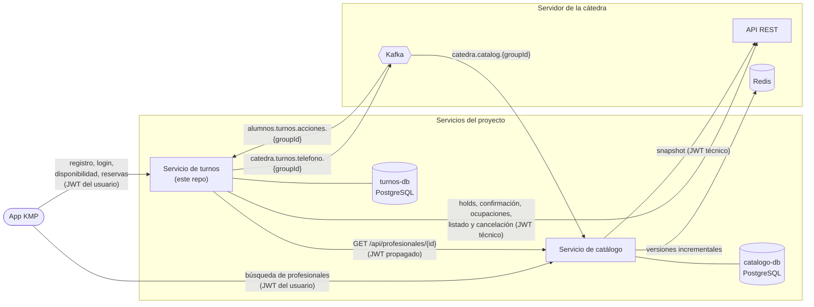

# Arquitectura

El servicio de turnos registra y autentica a los usuarios finales, arma la disponibilidad de un profesional y lleva adelante el proceso de reserva contra la cátedra. Es un backend Spring Boot 4 (Java 25) con su propia base PostgreSQL.

## Vista general



- **Turnos no usa Redis.** Redis y el topic `catedra.catalog.*` son del catálogo, que mantiene la copia local de categorías, profesionales y horarios.
- Turnos le pide al catálogo la **agenda de un profesional** (ver [contrato-con-catalogo.md](contrato-con-catalogo.md)) y a la cátedra las **ocupaciones** y las **operaciones de reserva** (holds, confirmación, listado, cancelación).
- El resultado de una reserva es **asincrónico**: la cátedra lo publica en el topic de acciones y turnos responde el pedido de teléfono en el topic de teléfono (ver [procesamiento-asincrono.md](procesamiento-asincrono.md)).
- Cada servicio tiene **su propia base** y ninguno lee la del otro.

## Capas hexagonales

El código sigue la arquitectura del repositorio de referencia de la cátedra ([dqmdz/hexagonal](https://github.com/dqmdz/hexagonal)): un paquete por *feature* y, adentro, una carpeta por capa.

```
ar.edu.um.programacion2.turnos
├── config/            Spring: seguridad, JWT, clientes REST, Kafka, Clock, scheduling
├── usuario/           CU-01, CU-02 (registro, login, cuenta)
├── disponibilidad/    CU-03 (turnos libres de un profesional)
└── reserva/           CU-04 a CU-10 (proceso de reserva)
    ├── domain/
    │   ├── model/          modelos de dominio (solo Lombok y java.*)
    │   ├── exception/      TransicionInvalidaException
    │   └── ports/
    │       ├── in/         un caso de uso por interfaz
    │       └── out/        repositorios, clientes y publicadores
    ├── application/
    │   ├── usecases/       XxxUseCaseImpl: las reglas de negocio
    │   ├── service/        ReservaService: fachada para el controller
    │   └── exception/      excepciones que traduce el controller
    └── infrastructure/
        ├── persistence/    entidad JPA, Spring Data, mapper y adaptador
        ├── client/         adaptador REST de la cátedra, DTOs y mapper
        ├── messaging/      consumidor y productor de Kafka, DTOs y mappers
        ├── scheduling/     reconciliación al arrancar y periódica
        └── web/            controller, DTOs y mapper
```

Reglas que se cumplen en los tres *features*:

- **El dominio no depende de Spring ni de JPA.** `domain/model` y `domain/ports` solo importan Lombok y `java.*`.
- **Los casos de uso dependen solo de puertos.** Por ejemplo, `InformarTelefonoUseCaseImpl` recibe un `TelefonoEventPublisher` y no sabe que abajo está Kafka.
- **El controller habla solo con el Service y con su mapper de DTOs.** Nunca devuelve el modelo de dominio ni la entidad.
- **Los mappers están escritos a mano** (`@Component`, con chequeo de `null`). Inyección por constructor con `@RequiredArgsConstructor`.
- **Un consumidor de Kafka o un scheduler es un adaptador de entrada.** Llama directo al puerto de entrada, igual que un controller.

### Puertos y adaptadores

| Feature | Puertos de entrada | Puertos de salida | Adaptadores |
| --- | --- | --- | --- |
| `usuario` | `CreateUsuarioUseCase`, `AuthenticateUsuarioUseCase`, `GetUsuarioByLoginUseCase` | `UsuarioRepository`, `PasswordHasher`, `TokenGenerator` | `JpaUsuarioRepositoryAdapter`, `Argon2PasswordHasherAdapter`, `JwtTokenGeneratorAdapter`, `UsuarioController` |
| `disponibilidad` | `ConsultarDisponibilidadUseCase` | `CatalogoClient`, `OcupacionesCatedraClient` | `HttpCatalogoClientAdapter`, `HttpOcupacionesCatedraClientAdapter`, `DisponibilidadController` |
| `reserva` | `IniciarReservaUseCase`, `GetProcesoReservaUseCase`, `GetMisReservasUseCase`, `InformarTelefonoUseCase`, `AbandonarProcesoUseCase`, `CancelarReservaUseCase`, `ProcesarEventoReservaUseCase`, `ReconciliarProcesosUseCase` | `ProcesoReservaRepository`, `EventoProcesadoRepository`, `ReservasCatedraClient`, `TelefonoEventPublisher` | `JpaProcesoReservaRepositoryAdapter`, `JpaEventoProcesadoRepositoryAdapter`, `HttpReservasCatedraClientAdapter`, `KafkaTelefonoEventPublisherAdapter`, `EventoReservaConsumer`, `ReconciliacionScheduler`, `ReservaController` |

`reserva` también usa puertos de salida de los otros *features*: `UsuarioRepository` (dueño del proceso y `externalPatientId`) y `CatalogoClient` (agenda del profesional al iniciar una reserva).

### Flujo de un pedido

```
ReservaController → ReservaService → XxxUseCase (in) → XxxUseCaseImpl
    → ProcesoReservaRepository (out) → JpaProcesoReservaRepositoryAdapter → PostgreSQL
    → ReservasCatedraClient (out)    → HttpReservasCatedraClientAdapter   → API de la cátedra
    → TelefonoEventPublisher (out)   → KafkaTelefonoEventPublisherAdapter → Kafka
```

## Tecnologías

| Pieza | Uso |
| --- | --- |
| Spring Boot 4.1, Java 25 | Base del servicio |
| Spring Web MVC + `RestClient` | API propia y clientes del catálogo y de la cátedra |
| Spring Security + OAuth2 Resource Server | Validación del JWT del usuario |
| Spring Data JPA + PostgreSQL 17 + Flyway | Persistencia y migraciones (H2 solo en los tests) |
| Spring for Apache Kafka | Consumidor del topic de acciones y productor del topic de teléfono |
| springdoc | Swagger UI en `/swagger-ui.html` |
| JUnit 5, Mockito, JaCoCo, SonarCloud | Tests, cobertura y análisis (ver [pruebas.md](pruebas.md)) |
