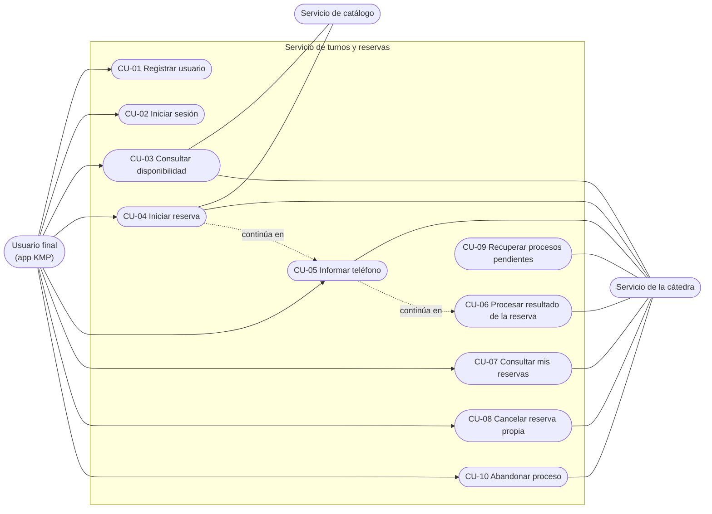
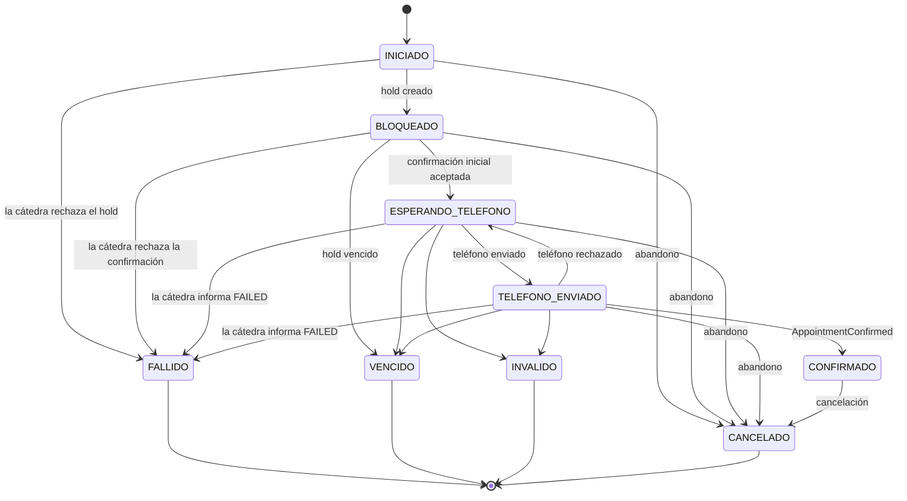

# Casos de uso — Servicio de turnos y reservas

Este documento describe **qué hace** el servicio desde el punto de vista de quienes lo usan. No define clases, tablas ni endpoints: eso se decide en el diseño de cada funcionalidad.

**Fuentes:** enunciado del proyecto (secciones 3.2, 4.2, 5, 7, 8 y 9) y contrato de integración con la cátedra (secciones 2, 8 a 13, 15, 17 y 18).

## Responsabilidad del servicio

El servicio administra a los **usuarios finales** de la aplicación (registro e inicio de sesión) y todo el **proceso de reserva**: arma la disponibilidad combinando la agenda vigente del catálogo con las ocupaciones de la cátedra, pide y confirma el bloqueo temporal, participa del intercambio por Kafka, guarda el estado local de cada proceso asociado a su usuario y permite consultar y cancelar las reservas propias.

## Actores

| Actor | Tipo | Qué hace con el servicio |
| --- | --- | --- |
| **Usuario final** (desde la app KMP) | Principal | Se registra e inicia sesión. Consulta disponibilidad, reserva un turno, informa su teléfono, consulta y cancela sus reservas. |
| **Servicio de catálogo** | De apoyo | Entrega los datos vigentes del profesional y su agenda semanal (CU-05 del catálogo). |
| **Servicio de la cátedra** | De apoyo | Informa ocupaciones, crea y confirma holds, lista y cancela reservas (REST). Pide el teléfono y entrega los resultados del proceso (Kafka). |

La recuperación de procesos pendientes no la inicia una persona: se dispara al arrancar el servicio y periódicamente.

## Diagrama

## Índice

| Caso | Resultado principal |
| --- | --- |
| [CU-01 Registrar usuario](CU-01-registrar-usuario.md) | El usuario queda registrado y activo, con su contraseña guardada como hash. |
| [CU-02 Iniciar sesión](CU-02-iniciar-sesion.md) | El usuario recibe un JWT para usar las funcionalidades protegidas. |
| [CU-03 Consultar disponibilidad](CU-03-consultar-disponibilidad.md) | El usuario ve los turnos libres de un profesional para una fecha. |
| [CU-04 Iniciar reserva](CU-04-iniciar-reserva.md) | El turno queda bloqueado y confirmado inicialmente; el proceso espera el pedido de teléfono. |
| [CU-05 Informar teléfono](CU-05-informar-telefono.md) | El teléfono del usuario llega a la cátedra como respuesta al pedido recibido. |
| [CU-06 Procesar resultado de la reserva](CU-06-procesar-resultado-de-la-reserva.md) | El proceso local refleja la confirmación, el rechazo, el vencimiento, la invalidez o la cancelación. |
| [CU-07 Consultar mis reservas](CU-07-consultar-mis-reservas.md) | El usuario ve solamente sus procesos y reservas, con el estado al día. |
| [CU-08 Cancelar reserva propia](CU-08-cancelar-reserva-propia.md) | Una reserva confirmada del usuario queda cancelada en la cátedra y localmente. |
| [CU-09 Recuperar procesos pendientes](CU-09-recuperar-procesos-pendientes.md) | Ningún proceso queda trabado: cada uno converge a su estado real. |
| [CU-10 Abandonar proceso](CU-10-abandonar-proceso.md) | El usuario suelta un turno bloqueado antes de que venza y el proceso queda cancelado. |

## Estados del proceso de reserva

`FALLIDO`, `VENCIDO`, `INVALIDO` y `CANCELADO` son **finales**: nada los modifica. `CONFIRMADO` solo puede pasar a `CANCELADO` (D-05).

## Decisiones del proyecto

| # | Decisión | Motivo |
| --- | --- | --- |
| D-01 | El registro y el inicio de sesión de usuarios finales viven en **este servicio**, que emite el JWT. El catálogo solo lo valida. | El enunciado pide un backend propio que registre, autentique y emita el JWT (enunciado 3.2 y 9). Turnos es el que necesita la identidad para asociar procesos y reservas a cada usuario (enunciado 4.2). |
| D-02 | El usuario sigue el modelo del usuario de **JHipster** (`login`, `firstName`, `lastName`, `email`, `imageUrl`, `langKey`, activado, autoridades y auditoría) con sus mismas validaciones. Queda activo al registrarse, con autoridad `ROLE_USER`. | Compatibilidad pedida con el usuario generado por JHipster (enunciado 3.2). |
| D-03 | El `externalPatientId` que se envía a la cátedra es un **identificador estable del usuario generado por el backend**, nunca un dato elegido por el cliente. | La cátedra no conoce a los usuarios finales y el contrato pide un identificador estable (contrato 2). No se confía en identificadores enviados por el cliente (enunciado 9). |
| D-04 | El proceso local se **guarda antes** de cada llamada con efectos a la cátedra, y se actualiza con los identificadores recibidos (`holdId`, `reservationProcessId`, `expiresAt`). | Ante un reinicio o un timeout, hace falta saber qué se intentó para reconciliar en vez de repetir a ciegas (contrato 18.4). |
| D-05 | Un proceso en estado **final no cambia más**, y `CONFIRMADO` solo puede pasar a `CANCELADO`. Un evento o respuesta tardía que intente moverlo se registra y se ignora. | El proceso debe converger sin retroceder un estado final (enunciado 7, contrato 18.3). |
| D-06 | La idempotencia de los eventos Kafka se resuelve **por `eventId`**: un evento ya procesado no produce efectos nuevos. El offset se confirma después de guardar el efecto. | Kafka entrega al menos una vez y puede duplicar mensajes (contrato 15.1 y 18.1). |
| D-07 | Si la cátedra responde `RESERVATION_PROCESS_ALREADY_CONFIRMED` al confirmar, se toma como **confirmación ya hecha**, no como error. | Es el caso de una confirmación repetida por timeout o respuesta perdida (enunciado 8). |
| D-08 | Ante un timeout en una operación con efectos, **primero se reconcilia** consultando a la cátedra con los identificadores guardados y recién después se decide si repetir. Los reintentos son limitados. | Un timeout no prueba que la operación haya fallado (contrato 18.4, enunciado 8). |
| D-09 | Si el catálogo no responde, **no se arman disponibilidades ni se inician reservas**. Consultar y cancelar reservas propias sigue funcionando. | No se pueden iniciar operaciones sin información vigente, pero sí atender las que dependen de datos propios (enunciado 8). |
| D-10 | Un turno está **libre** si sale de un horario semanal habilitado del profesional para ese día, partido según su duración, y no aparece en las ocupaciones (`CONFIRMED` ni `HELD`). No se ofrecen fechas ni horarios ya pasados. | Regla de disponibilidad del enunciado 7 y contrato 8. |
| D-11 | El teléfono se valida con la **misma regla de la cátedra** antes de enviarlo, para avisar el error al usuario sin gastar el tiempo del hold. | La cátedra limpia y valida el número con una expresión fija (contrato 15.5). |
| D-12 | "Mis reservas" se arma con los **procesos locales del usuario autenticado**, y se actualiza con la cátedra filtrando por su `externalPatientId`. Si la cátedra no responde, se muestran los datos locales indicando que pueden no estar al día. | La cátedra devuelve las reservas de toda la cuenta técnica; la propiedad por usuario la aplica el backend (enunciado 4.2, contrato 11). |
| D-13 | Un usuario solo ve, modifica o cancela **sus propios** procesos y reservas. Si pide uno ajeno, se responde igual que si no existiera. | Aislamiento obligatorio entre usuarios (enunciado 9) sin revelar que el recurso existe. |
| D-14 | Al arrancar y periódicamente se **reconcilian** con la cátedra los procesos no finales; los que superaron `expiresAt` y no tienen reserva confirmada pasan a `VENCIDO`. | Recuperar procesos pendientes o interrumpidos y procesar vencimientos (enunciado 4.2 y 8). |
| D-15 | Los errores que ve el usuario tienen un **motivo funcional**, sin tokens, contraseñas ni detalles internos; el detalle técnico queda en los logs (sin secretos). | Evitar exponer secretos o detalles internos (enunciado 9). |
| D-16 | El usuario puede **abandonar** un proceso pendiente con una acción explícita. Se usa la operación de cancelar reserva de la cátedra para liberar el hold. Salir de la app o volver atrás no abandona nada. | El profesor lo confirmó en Slack (#all-fi-programacion-2-2026, 29/09/2026): la cancelación de la sección 12 del contrato se puede usar para cancelar o abandonar un hold, aunque la matriz de errores (contrato 13.1) solo la admite para reservas confirmadas. |
| D-17 | Si la creación del hold no tiene respuesta, el proceso queda con **resultado incierto** en `INICIADO` y no se repite el pedido. CU-09 lo cierra como `FALLIDO` cuando pasó la vigencia máxima de un hold, porque cualquier hold creado ya venció solo. | Un timeout no prueba que la operación haya fallado (contrato 18.4) y sin `reservationProcessId` no hay con qué reconciliar. |

### Pendientes

- **Etapa de seguridad:** si la consulta a catálogo propaga el JWT del usuario o usa un JWT técnico entre servicios (mismo pendiente que CU-05 del catálogo).
- **Opcional:** rol administrador para gestionar reservas ajenas. Por ahora no se implementa.
