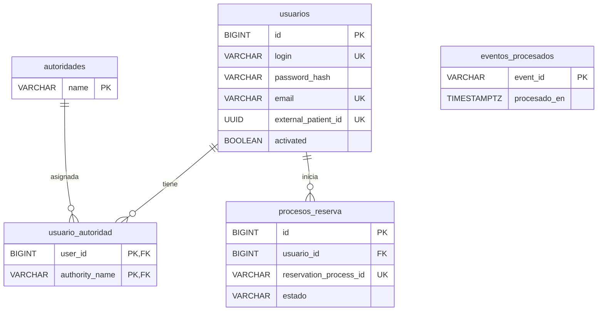

# Modelo de datos

La base de turnos (`turnos-db`, PostgreSQL 17) la crean las migraciones de Flyway en `src/main/resources/db/migration`. Hibernate solo valida que las entidades coincidan con las tablas (`spring.jpa.hibernate.ddl-auto=validate`). Una migración aplicada no se modifica: cada cambio va en un archivo nuevo.

| Migración | Qué hace |
| --- | --- |
| `V1__inicializar_esquema.sql` | No crea tablas: registra la versión inicial en `flyway_schema_history`. |
| `V2__crear_tablas_de_usuarios.sql` | `usuarios`, `autoridades`, `usuario_autoridad` y la autoridad `ROLE_USER`. |
| `V3__agrandar_password_hash.sql` | `password_hash` pasa de `VARCHAR(60)` (BCrypt) a `VARCHAR(255)` (Argon2id). |
| `V4__crear_tablas_de_procesos_de_reserva.sql` | `procesos_reserva` y `eventos_procesados`. |
| `V5__agregar_cancelada_en.sql` | `procesos_reserva.cancelada_en` (CU-08). |

## Diagrama

## Tablas

### `usuarios` (V2, V3)

Usuarios finales, con el modelo de usuario de JHipster (D-02). Las columnas siguen los nombres de JHipster.

| Columna | Tipo | Nulo | Notas |
| --- | --- | --- | --- |
| `id` | `BIGINT` identity | no | PK |
| `login` | `VARCHAR(50)` | no | único; se guarda en minúsculas |
| `password_hash` | `VARCHAR(255)` | no | hash Argon2id (ver [seguridad.md](seguridad.md)) |
| `first_name`, `last_name` | `VARCHAR(50)` | sí | obligatorios para reservar (la cátedra pide de 2 a 100 caracteres) |
| `email` | `VARCHAR(254)` | no | único; en minúsculas |
| `image_url` | `VARCHAR(256)` | sí | |
| `activated` | `BOOLEAN` | no | `true` al registrarse |
| `lang_key` | `VARCHAR(10)` | no | |
| `external_patient_id` | `UUID` | no | único; lo genera el backend y nunca cambia (D-03) |
| `created_by`, `created_date`, `last_modified_by`, `last_modified_date` | | | auditoría |

### `autoridades` y `usuario_autoridad` (V2)

Roles disponibles y su relación muchos a muchos con `usuarios`. La única autoridad es `ROLE_USER`, que se carga en la misma migración.

### `procesos_reserva` (V4, V5)

Un proceso por cada intento de reserva de un usuario, desde que pide el turno hasta su resultado final. Ver la máquina de estados en [procesamiento-asincrono.md](procesamiento-asincrono.md).

| Columna | Tipo | Nulo | Origen |
| --- | --- | --- | --- |
| `id` | `BIGINT` identity | no | turnos |
| `usuario_id` | `BIGINT` | no | turnos; FK a `usuarios` (D-13) |
| `profesional_id` | `BIGINT` | no | pedido del usuario |
| `fecha`, `hora_inicio`, `hora_fin` | `DATE`, `TIME`, `TIME` | no | pedido del usuario; `hora_fin` sale de la agenda del catálogo |
| `profesional_nombre`, `profesional_apellido` | `VARCHAR(100)` | sí | copia del catálogo al iniciar (historial; no reemplaza al catálogo vigente) |
| `hold_id` | `VARCHAR(100)` | sí | cátedra, al crear el hold |
| `reservation_process_id` | `VARCHAR(100)` | sí | cátedra, al crear el hold; único; es la *message key* de Kafka |
| `expires_at` | `TIMESTAMPTZ` | sí | cátedra (hold, confirmación o pedido de teléfono) |
| `request_event_id` | `VARCHAR(100)` | sí | `eventId` del `AdditionalInformationRequested` |
| `mensaje_pedido` | `VARCHAR(500)` | sí | mensaje del pedido o del rechazo del teléfono |
| `telefono` | `VARCHAR(30)` | sí | usuario, ya normalizado (D-11); no se expone en la API ni se registra en logs |
| `reservation_id` | `BIGINT` | sí | cátedra, al confirmarse la reserva |
| `motivo` | `VARCHAR(500)` | sí | último motivo: código de la cátedra (`HOLD_EXPIRED`, `SLOT_ALREADY_HELD`...) o motivo local (abandono, cancelación, reconciliación) |
| `estado` | `VARCHAR(20)` | no | turnos (`EstadoProceso`) |
| `creado_en`, `actualizado_en` | `TIMESTAMPTZ` | no | turnos |
| `cancelada_en` | `TIMESTAMPTZ` | sí | cátedra (`cancelledAt`) o la hora local si no lo informa (V5) |

Restricciones e índices:

- `uk_procesos_reserva_reservation_process_id`: un `reservation_process_id` nunca se repite. Queda `NULL` hasta que se crea el hold.
- `idx_procesos_reserva_usuario`: "mis reservas" (CU-07) busca siempre por usuario.

### `eventos_procesados` (V4)

`eventId` de cada evento de Kafka ya procesado, con la hora en que se procesó. Se guarda en la misma transacción que el efecto del evento: o quedan los dos o ninguno (D-06). Un `eventId` repetido no vuelve a producir efectos (contrato 18.1).

## Qué es de quién

| Dato | Dueño | Qué guarda turnos |
| --- | --- | --- |
| Usuario final, credenciales y roles | **Turnos** | Todo (`usuarios`, `autoridades`, `usuario_autoridad`). Ningún otro servicio lo tiene. |
| Identidad del paciente ante la cátedra | **Turnos** | `external_patient_id`. La cátedra solo conoce este UUID, nombre, apellido y teléfono. |
| Categorías, profesionales y horarios | **Catálogo** (copia de la cátedra) | Nada vigente: los consulta en cada pedido. Solo copia el nombre y apellido del profesional en el proceso, como historial. |
| Holds, reservas y su estado real | **Cátedra** | Las referencias (`hold_id`, `reservation_process_id`, `reservation_id`, `expires_at`) y el estado local, que se reconcilia con la cátedra (CU-09). |
| Proceso de reserva del usuario | **Turnos** | Todo (`procesos_reserva`): es lo que ve la app. |
| Eventos de Kafka procesados | **Turnos** | `eventos_procesados`, solo para la idempotencia. |
