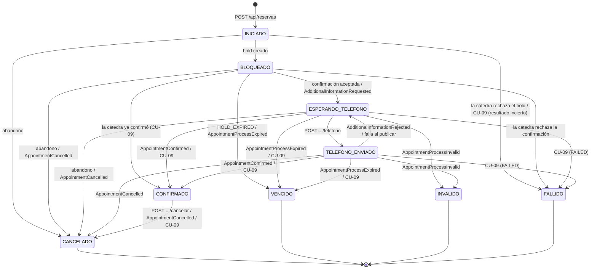

# Procesamiento asincrónico

El resultado de una reserva no llega en la respuesta REST. La cátedra lo decide después y lo publica por Kafka. Turnos lleva cada intento como un **proceso de reserva** (`procesos_reserva`) con una máquina de estados, y lo hace converger aunque los mensajes lleguen duplicados, fuera de orden o no lleguen.

## Topics

| Topic | Dirección | Eventos | Clave |
| --- | --- | --- | --- |
| `alumnos.turnos.acciones.{groupId}` (`KAFKA_TOPIC_ACCIONES`) | cátedra → turnos | `AdditionalInformationRequested`, `AdditionalInformationRejected`, `AppointmentConfirmed`, `AppointmentProcessExpired`, `AppointmentProcessInvalid`, `AppointmentCancelled` | `reservationProcessId` |
| `catedra.turnos.telefono.{groupId}` (`KAFKA_TOPIC_TELEFONO`) | turnos → cátedra | `AdditionalInformationSubmitted` | `reservationProcessId` |

Como la clave es el `reservationProcessId`, los eventos de un mismo proceso caen en la misma partición y conservan su orden (contrato 15.1).

## Máquina de estados

`EstadoProceso` define las transiciones permitidas. `ProcesoReserva.pasarA()` tira `TransicionInvalidaException` ante cualquier otra.

- `CANCELADO`, `VENCIDO`, `INVALIDO` y `FALLIDO` son **finales**: nada los mueve. `CONFIRMADO` solo puede pasar a `CANCELADO` (D-05).
- `BLOQUEADO` y `ESPERANDO_TELEFONO` pueden pasar directo a `CONFIRMADO`, porque la cátedra es la fuente de verdad del resultado. Pasa con un teléfono que dio timeout pero llegó, o con un evento perdido que encuentra la reconciliación.
- Desde `TELEFONO_ENVIADO` no se abandona: la cátedra ya tiene el teléfono y puede confirmar (D-16).

## Consumo de eventos (CU-05 parte A y CU-06)

`EventoReservaConsumer` (`@KafkaListener`) lee el topic de acciones con un consumer group propio (`KAFKA_GRUPO`):

1. **Descarta** los mensajes que no tienen arreglo: un JSON ilegible, uno sin `eventId` o sin `reservationProcessId`, o un `eventType` desconocido. Los registra en el log y no traban la partición.
2. `EventoReservaMessageMapper` traduce el `eventType` a `TipoEventoReserva`, que sabe a qué estado lleva cada evento.
3. `ProcesarEventoReservaUseCaseImpl` aplica el evento en **una transacción** (`@Transactional`), junto con el registro del `eventId`.

| Evento | Estado destino | Qué se guarda |
| --- | --- | --- |
| `AdditionalInformationRequested` | `ESPERANDO_TELEFONO` | `requestEventId` (= `eventId`), mensaje, `expiresAt` |
| `AdditionalInformationRejected` | `ESPERANDO_TELEFONO` | motivo, mensaje, `expiresAt` |
| `AppointmentConfirmed` | `CONFIRMADO` | `reservationId`; borra el motivo |
| `AppointmentProcessExpired` | `VENCIDO` | motivo |
| `AppointmentProcessInvalid` | `INVALIDO` | motivo |
| `AppointmentCancelled` | `CANCELADO` | motivo |

## Idempotencia por `eventId` (D-06)

- Antes de aplicar un evento se busca su `eventId` en `eventos_procesados`. Si ya está, el evento no tiene efecto.
- El efecto en `procesos_reserva` y el registro en `eventos_procesados` se guardan **en la misma transacción**: o quedan los dos o ninguno.
- El offset se confirma recién cuando el listener termina, es decir, después del commit (`spring.kafka.listener.ack-mode=record`).
  - Si el servicio se cae entre el commit y la confirmación del offset, el mensaje vuelve a llegar y el `eventId` registrado lo vuelve inocuo.
- Un evento de un `reservationProcessId` que no es de esta aplicación se registra como procesado y no hace nada.

## Orden entre REST y Kafka

- **El pedido de teléfono llega antes que la respuesta REST de la confirmación** (CU-05 4b). El evento ya dejó el proceso en `ESPERANDO_TELEFONO`. Al volver la respuesta REST, `IniciarReservaUseCaseImpl` relee el proceso y, como ya no está `BLOQUEADO`, no lo toca.
- **Se guarda antes de cada operación con efectos** (D-04):
  - El proceso se guarda `INICIADO` antes de crear el hold y `BLOQUEADO` antes de confirmarlo.
  - Al informar el teléfono, se guarda `TELEFONO_ENVIADO` **antes** de publicar. Si `AppointmentConfirmed` llega enseguida, encuentra el proceso en el estado que lo espera. Si la publicación falla, el proceso vuelve a `ESPERANDO_TELEFONO`, salvo que otro evento ya lo haya movido.
  - Al cancelar (CU-08), el motivo se guarda antes de llamar a la cátedra.
- **Releer antes de decidir.** La cancelación, la reconciliación y la vuelta atrás del teléfono releen el proceso antes de guardar. Si un evento lo movió mientras tanto, no se pisa.

## Reintentos

| Dónde | Política |
| --- | --- |
| Consumidor de Kafka | Si guardar falla (por ejemplo, la base no responde), la excepción llega al contenedor, que vuelve al mismo offset y reintenta **cada 5 s sin límite** (`KafkaConfig`). El valor por defecto de Spring saltea el mensaje a los 10 intentos y perdería el evento. |
| Productor del teléfono | `acks=all`, hasta 3 reintentos dentro de `delivery.timeout.ms=10000`, `max.block.ms=5000`. El caso de uso espera la confirmación hasta 15 s (`KAFKA_TIMEOUT_ENVIO`); si no llega, responde `503`. |
| Crear el hold | **No se repite** ante un timeout (D-17): el proceso queda `INICIADO` con resultado incierto y lo cierra la reconciliación. |
| Confirmar el hold | No se repite: el proceso queda `BLOQUEADO` y lo resuelve la reconciliación. |
| Disponibilidad | Hasta 3 intentos con 500 ms entre uno y otro, solo si el catálogo o la cátedra no responden. |
| Reconciliación | Un intento por usuario en cada vuelta (1 minuto por defecto); si falla, sigue en la próxima. |

## Reconciliación (CU-09)

`ReconciliacionScheduler` dispara `ReconciliarProcesosUseCaseImpl` en dos momentos:

- **Al arrancar** (`ApplicationReadyEvent`).
- **Cada `RECONCILIACION_INTERVALO`** (`@Scheduled`, 1 minuto por defecto).

Un `ReentrantLock` con `tryLock` hace que una vuelta que encuentra otra en curso se saltee (supuesto: una sola instancia).

1. Busca los procesos pendientes (`INICIADO`, `BLOQUEADO`, `ESPERANDO_TELEFONO`, `TELEFONO_ENVIADO`) y los `CONFIRMADO` con turno de hoy en adelante.
2. **`INICIADO`**: no se consulta a la cátedra. Sin `holdId` no hay cómo identificarlo, y un hold `HELD` de la cuenta técnica no prueba que sea propio. Pasados 10 minutos (la vigencia de un hold) desde `creadoEn`, pasa a `FALLIDO` con motivo "Resultado incierto al crear el hold".
3. Para el resto, una consulta por usuario: `GET /api/appointments?externalPatientId=...&page=N&size=100`. Va sin `from`/`to`, porque con esos filtros la cátedra responde 500.
4. Relee cada proceso y aplica, siempre por la máquina de estados:

| Estado local | La cátedra informa | Resultado |
| --- | --- | --- |
| `BLOQUEADO` / `ESPERANDO_TELEFONO` / `TELEFONO_ENVIADO` | `CONFIRMED` | `CONFIRMADO`, con `reservationId` |
| ídem | `CANCELLED` | `CANCELADO` |
| ídem | `FAILED` | `VENCIDO` si pasó `expiresAt`; si no, `FALLIDO` |
| ídem | `PHONE_PENDING` vencido | `VENCIDO` |
| `BLOQUEADO` | `PHONE_PENDING` vigente | `ESPERANDO_TELEFONO`, sin `requestEventId`: el teléfono no se puede informar hasta que llegue el pedido por Kafka |
| ídem | no aparece y venció | `VENCIDO` |
| `CONFIRMADO` | `CANCELLED` | `CANCELADO` (cancelación que dio timeout o `AppointmentCancelled` perdido) |
| cualquiera | otro caso o `status` desconocido | sin cambios |

5. Registra cuántos procesos revisó y cuántos cambió. Si la cátedra no responde para un usuario, sus procesos no se tocan y se sigue con los demás.

## Duplicados, perdidos y fuera de orden

| Situación | Qué pasa |
| --- | --- |
| **Evento duplicado** (mismo `eventId`) | Se reconoce en `eventos_procesados` y no tiene efecto; el offset se confirma igual (contrato 18.1). |
| **Mismo resultado con otro `eventId`** (por ejemplo, `AppointmentCancelled` de una cancelación que ya se aplicó por REST) | La transición a un estado igual al actual se ignora. Excepción: llegar a `ESPERANDO_TELEFONO` estando ahí actualiza los datos del pedido. |
| **Evento tardío o fuera de orden** (por ejemplo, `AppointmentConfirmed` después de `AppointmentProcessExpired`) | La transición no está permitida desde un estado final: se registra y se ignora (D-05). Un estado final nunca se reabre. |
| **Evento perdido**, o publicado mientras turnos estaba caído | Si turnos estaba caído, el consumer group retoma desde el último offset confirmado (`auto-offset-reset=earliest` para un grupo nuevo). Si el evento no llega nunca, la reconciliación lleva el proceso al estado que informa la cátedra. |
| **Fallo al guardar un evento** | El offset no se confirma y el mismo mensaje se reintenta cada 5 s. |
| **Mensaje ilegible o desconocido** | Se descarta y se registra; reintentarlo no lo arreglaría. |
| **Teléfono enviado dos veces** | Comportamiento conocido. Si el broker recibió el mensaje pero no confirmó a tiempo, el usuario ve `503` y puede reenviar. La cátedra recibe entonces dos `AdditionalInformationSubmitted` con distinto `eventId` y el mismo `requestEventId`; el contrato admite reenvíos (15.7). |
| **Timeout con efectos inciertos** (crear hold, confirmar, cancelar) | No se repite a ciegas (contrato 18.4): el estado guardado antes de la llamada (D-04) le dice a la reconciliación qué revisar. |
